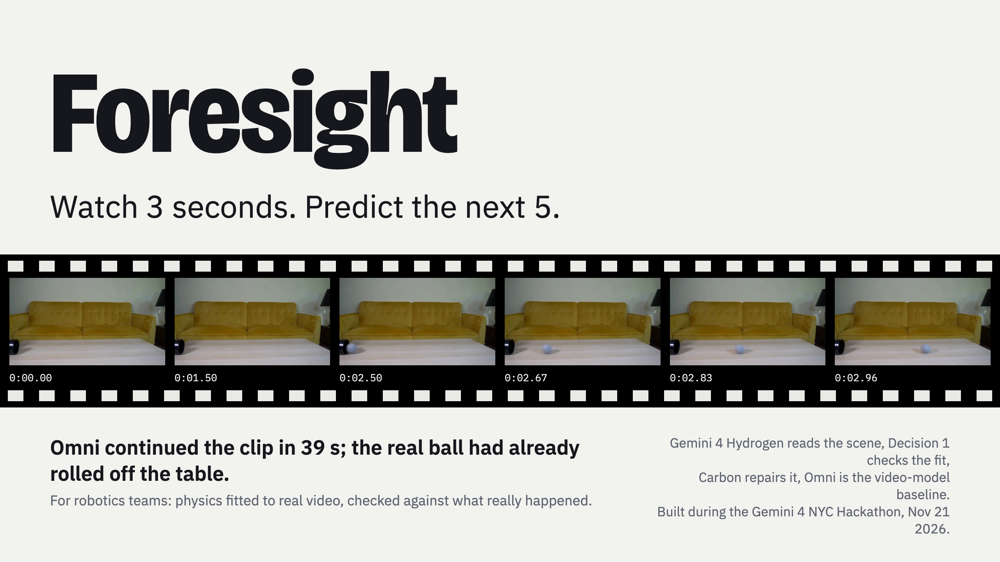
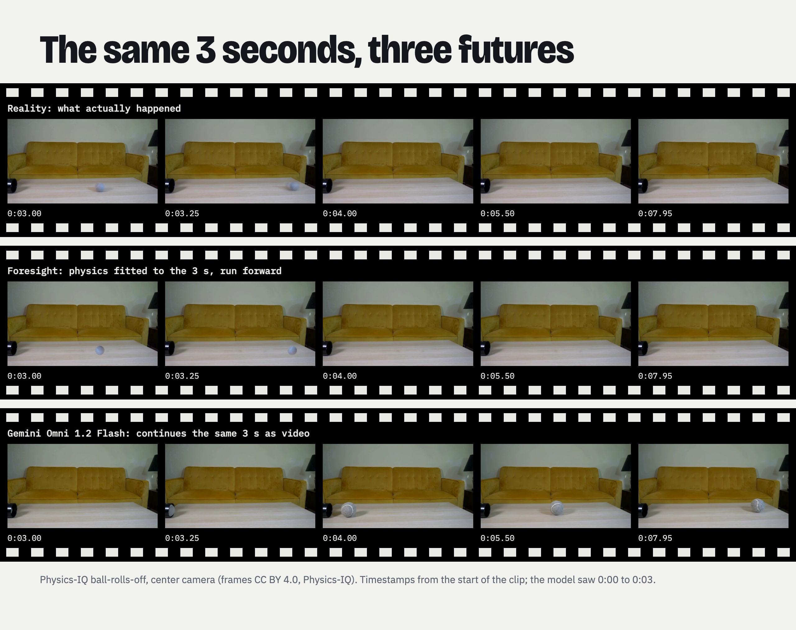
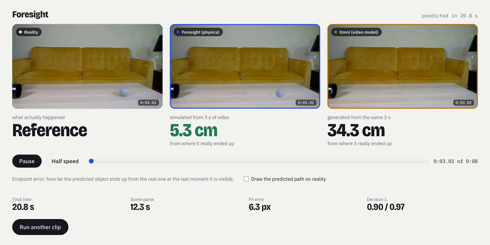
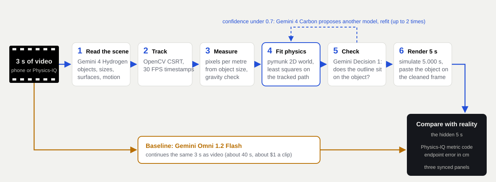

<p align="center"></p>

<p align="center">
  <b>For robotics teams: watch 3 seconds of real video, simulate the physics, and predict the next 5, where video models get physics wrong.</b><br>
  <sub>Built during the Gemini 4 NYC Hackathon · November 21, 2026</sub>
</p>

<p align="center">
  <a href="#why-it-matters">Why it matters</a> ·
  <a href="#try-it-in-30-seconds"><b>Try it in 30 seconds</b></a> ·
  <a href="#results">Results</a> ·
  <a href="#how-it-works">How it works</a> ·
  <a href="docs/developer-guide.md">Developer guide</a>
</p>

A robot that pushes, drops or rolls things needs to know where they will be a few seconds from now. Video models
can show that, but they make up physics: given a clip of a rolling ball, Gemini Omni made the ball vanish and a
new one roll out of the pipe. Foresight reads the real scene with Gemini, fits a physics world to what it saw,
and runs it forward 5 seconds, so you get a prediction and the trajectory behind it.

<p align="center"></p>

## Why it matters

A robot that acts around moving things needs more than a plausible video: it needs to know where the object will
be, how sure that is, and why. Foresight gives all three.

- **A trajectory a planner can use.** Every run returns the object's path in metres and the physics behind it:
  starting speed, friction, bounce. A robot can ask "where will the ball be when my gripper gets there?" or
  "will it roll off the bench?" and get an answer it can act on, not pixels to interpret.
- **It says when it might be wrong.** Gemini Decision 1 checks the fitted motion against the real frames and
  returns a confidence with every prediction; a doubtful fit is repaired by Gemini 4 Carbon, and the confidence is
  reported either way. A robot can slow down or look again when the check is unsure.
- **Nothing to train.** No dataset, no fine-tuning: a few seconds of phone video and a handful of Gemini calls,
  on a scene it has never seen.
- **Real footage, real scores.** It is scored with the official Physics-IQ code on real clips, next to a video
  model and two simple baselines, so you can see where it helps and where it does not yet.

Where it fits:

- **Manipulation around moving objects:** catching, pushing, or clearing a rolling or falling object.
- **Tuning a simulator from real video:** the fitted friction, bounce and damping come out as numbers you can put
  into your own simulator (`physics.fit_params` in each run's `result.json`).
- **Checking a video world model:** run Foresight next to it on your own footage and see where the video model
  makes up physics, like the ball that vanished above.

## Try it in 30 seconds

With the [setup](docs/developer-guide.md#setup-about-2-minutes) done and a Gemini API key in `.env`:

```bash
PYTHONPATH=backend uvicorn foresight.api:app --app-dir backend --host 0.0.0.0 --port 8000
npm --prefix frontend run dev
```

Open `https://<your-lan-ip>:5173`. Pick a Physics-IQ clip (rolling ones are quick; falls can take a few minutes while Gemini repairs the fit), or scan the QR code with
a phone, prop it up side-on and roll a ball through the frame. You see only the first 3 seconds while each step
reports in, then reality, Foresight and Omni play side by side with how far each prediction ends up from the
real object.

<p align="center"></p>

<sub>The stage after a live run, 0.25 s into the hidden 5 seconds: the real ball and Foresight's ball are in the same place; Omni's ball has vanished.</sub>

<!-- results: start (written by eval/readme_results.py from eval/results.json; edits here are lost) -->
## Results

Every number below comes from `eval/run_eval.py`: [eval/results.json](eval/results.json), [the per-clip table](eval/results_table.md), [the method](docs/evaluation.md). 15 rigid-body clips, center camera, 24 FPS, scored against the original Physics-IQ ground truth (Verified files were not available) with the official Physics-IQ code. Clean run: yes; commit `f84ff62`, 2026-11-21T20:40:02+00:00.

**In short:** Physics-IQ score (Verified formula, %, higher is better): Constant velocity (no physics) 75.2, Foresight (physics) 59.0, Last frame held 35.0, Gemini Omni 1.2 Flash (video model) 27.5.

Foresight beats Gemini Omni by a wide margin. It does **not** yet beat the constant-velocity baseline, which uses the same Gemini scene reading, tracking and renderer and only drops the physics. Where the physics fit works it is more accurate: Foresight's object ends closer to the real one on 8 of the 14 clips with a measurable endpoint (on ball-rolls-off, 5.7 cm against 9.9 cm). But the fit blew up on 4 clips with collisions or falls (roll-in-box, ball-and-block-fall, balls-collide, two-balls-pass), and those pull the pooled score down. Making contacts and falls robust is the next step.

<p align="center"></p>

| System | Physics-IQ score (Verified formula) | Original formula | Median endpoint error (cm) | Failed clips |
|---|---|---|---|---|
| Constant velocity (no physics) | **75.2** | 76.2 | 438.1 | 0 of 15 |
| Foresight (physics) | 59.0 | 55.2 | 42.5 | 0 of 15 |
| Last frame held | 35.0 | 32.4 | n/a | 0 of 15 |
| Gemini Omni 1.2 Flash (video model) | 27.5 | 21.6 | n/a | 0 of 15 |

Endpoint error is measured only where the system tracks an object (Foresight and constant velocity). Failures, causes and fixes: [eval/FAILURES.md](eval/FAILURES.md).
<!-- results: end -->

## How it works

1. **Read the scene.** Gemini 4 Hydrogen watches the clip (agentic video) and returns, as structured output, each
   object as a circle or a box with its real size, the surfaces it moves on, and the kind of motion.
2. **Track.** OpenCV CSRT follows the object frame by frame, with real timestamps from the 30 FPS clip.
3. **Measure.** Pixels per metre come from the object's real size; falls are cross-checked against gravity.
4. **Fit physics.** A pymunk world is fitted to the tracked path with least squares: start position, velocity,
   and the friction and bounce the clip can reveal.
5. **Check and repair.** Gemini Decision 1 looks at the fitted outline on real frames and says whether it sits on
   the object and what the motion is, with a confidence. Under 0.7, Gemini 4 Carbon proposes another motion model
   and the fit runs again.
6. **Render.** The world runs for exactly 5.000 s and the object is drawn onto the frame it was cleaned from.

<p align="center"></p>

<sub>The simple view: six steps, the repair loop, and the Omni baseline.</sub>

<p align="center"></p>

<sub>The detailed view: where each part runs. Blue is the live path from the phone to the stage, with the step that makes each Gemini call on its arrow; amber is the Omni baseline; grey dashes are the offline eval, which calls the same pipeline. More in [docs/architecture.md](docs/architecture.md).</sub>

## Gemini models, each with a job

| Model | Its job |
|---|---|
| Gemini 4 Hydrogen (`gemini-4-hydrogen`) | Reads the clip: objects, sizes, surfaces, motion (agentic video, structured output, thinking level low). 12.5 s in [Phase 0](phase0/REPORT.md). |
| Gemini 4 Neon (`gemini-4-neon`) | On standby: takes over scene reading if Hydrogen keeps returning 503. Not needed in any run today. |
| Gemini Decision 1 (`gemini-decision-1`) | Checks the fit on real frames: does the outline sit on the object, which motion is it; confidences gate the repair. |
| Gemini 4 Carbon (`gemini-4-carbon`) | Repairs a fit Decision 1 doubts: proposes another motion model and starting guesses (thinking level medium). |
| Gemini Omni 1.2 Flash (`gemini-omni-1.2-flash`) | The baseline: continues the same 3 s as video. |
| Gemini Robotics-ER 2 (`gemini-robotics-er-2-preview`) | Tested as a tracker in Phase 0 and not used: 39 px median error against 20 px for CSRT. |

## Limitations, in plain words

- **Side view, rigid objects, still camera.** Foresight models balls and boxes moving in the image plane. A ball
  rolling toward the camera, a cloth or a liquid is out of scope.
- **Short motion.** In Physics-IQ the object often moves for only the last 0.2 to 0.6 s of the 3 s it is shown,
  so the fit leans on gravity and the object's known size.
- **Scale comes from Gemini's size estimate.** A wrong size (a 6.7 cm tennis ball called 10 cm) scales every
  distance by the same factor; falls are cross-checked against gravity, rolls are not.
- **A subset of Physics-IQ.** 15 of 66 scenes and one of three cameras, so the scores are not comparable with the
  public leaderboard.
- **Physics is not yet better than a straight line on this score.** Contacts and falls are where the fit breaks;
  the results above name the clips. Constant velocity shares Foresight's perception and tracking, so most of the
  gap to Omni comes from reading the real scene rather than generating pixels.
- **The score likes stillness.** Holding the last frame scores well on Physics-IQ because the pixel-error term
  rewards a video that does not change. The table shows it so you can judge.
- **Omni is slow and paid.** It took a median 38.9 s a clip in the eval and is billed per second of video, so
  the stage asks before calling it.

## Docs

| | |
|---|---|
| **Architecture** | [docs/architecture.md](docs/architecture.md) |
| **Evaluation** | [docs/evaluation.md](docs/evaluation.md), [per-clip results](eval/results_table.md), [failures and fixes](eval/FAILURES.md) |
| **Phase 0 checks** | [phase0/REPORT.md](phase0/REPORT.md): scoring a subset, Hydrogen perception, CSRT against Robotics-ER 2, Omni continuation |
| **Developer guide** | [docs/developer-guide.md](docs/developer-guide.md): setup, demo, eval |
| **Data and licenses** | [docs/data-and-licenses.md](docs/data-and-licenses.md) |

## Data and credits

Evaluation clips and scoring code come from [Physics-IQ](https://github.com/google-deepmind/physics-IQ-benchmark)
(Motamed et al., Google DeepMind; code Apache-2.0, materials CC BY 4.0) and
[Physics-IQ Verified](https://huggingface.co/datasets/Anates-Labs-Research/Physics-IQ-Verified) (Anates Labs
Research). No dataset files are in this repository; the images above contain a few Physics-IQ frames, credited
in their captions.

Built during the Gemini 4 NYC Hackathon (November 21, 2026); all code was written during the event. MIT license,
see [LICENSE](LICENSE).
