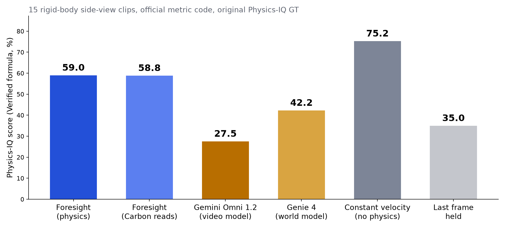
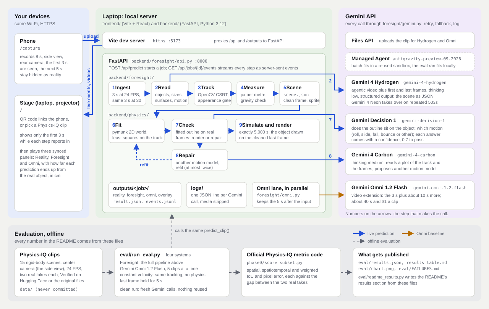

<p align="center"></p>

<p align="center">
  <b>For robotics teams: watch 3 seconds of real video, simulate the physics, and predict the next 5, where video models get physics wrong.</b><br>
  <sub>Built during the Gemini 4 NYC Hackathon · November 21, 2026 · improved since</sub>
</p>

<p align="center">
  <a href="https://youtu.be/uZtcHMUKOVQ"><b>Watch the demo (1 min)</b></a> ·
  <a href="#why-it-matters">Why it matters</a> ·
  <a href="#try-it-in-30-seconds"><b>Try it in 30 seconds</b></a> ·
  <a href="#post-hackathon-changes">Post-hackathon changes</a> ·
  <a href="#results">Results</a> ·
  <a href="#how-it-works">How it works</a> ·
  <a href="docs/developer-guide.md">Developer guide</a>
</p>

A robot that pushes, drops or rolls things needs to know where they will be a few seconds from now. Video models
can show that, but they make up physics: given a clip of a rolling ball, Gemini Omni made the ball vanish and a
new one roll out of the pipe. Foresight reads the real scene with Gemini, fits a physics world to what it saw,
and runs it forward 5 seconds, so you get a prediction and the trajectory behind it.

<p align="center"></p>

## Why it matters

Video models are getting good at making things look right, but not at making them move right. Anyone building
world models or running robot experiments needs predictions that follow real physics.

- **For world-model builders:** a physics-checked reference to test video models against. On your own footage,
  Foresight shows where a video model makes up physics, like the ball that vanished above.
- **For robotics experiments:** a few seconds of phone video becomes a simulation of the real object. Its speed,
  friction and bounce come out as numbers you can use in your own simulator, so what you try in simulation
  matches the real world.
- **For robots that act around moving things:** a predicted path in metres plus a confidence, so a robot knows
  where an object will be and how sure that is.
- **Nothing to train:** a few seconds of video and a few Gemini calls, on a scene it has never seen.

## Try it in 30 seconds

With the [setup](docs/developer-guide.md#setup-about-2-minutes) done and a Gemini API key in `.env`:

```bash
PYTHONPATH=backend uvicorn foresight.api:app --app-dir backend --host 0.0.0.0 --port 8000
npm --prefix frontend run dev
```

Open `https://<your-lan-ip>:5173`. Pick a Physics-IQ clip (rolling ones are quick; falls can take a few minutes while Gemini repairs the fit), or scan the QR code with
a phone, prop it up side-on and roll a ball through the frame. You see only the first 3 seconds while each step
reports in, then reality, Foresight, Omni and Genie 4 play side by side with how far each prediction ends up from
the real object.

<p align="center"></p>

<sub>The stage after a live run, 0.25 s into the hidden 5 seconds: the real ball and Foresight's ball are in the same place; Omni's ball has vanished.</sub>

## Post-hackathon changes

The version submitted to the Gemini 4 NYC Hackathon (November 21, 2026) is kept unchanged on the branch
[`hackathon-submission-branch-archive`](https://github.com/amaan784/foresight-worlds/tree/hackathon-submission-branch-archive),
at commit [`b3b3f79`](https://github.com/amaan784/foresight-worlds/commit/b3b3f791e5ac77e9fbe3c148e65c692e7c5f2da1) (`b3b3f791e5ac77e9fbe3c148e65c692e7c5f2da1`). Everything in this section
was added after the event, starting November 22, and the work is ongoing on `main`. What failed and why each change was made: [eval/FAILURES.md](eval/FAILURES.md).

**Physics that holds up on contacts and falls**
- Depth from where things touch the table: a box in front of the ball hides it instead of stopping it, balls rolling
  at two distances from the camera pass each other, and only objects at the same depth collide.
- Resting objects (balls in a row, a rubber duck) are bodies that can be knocked; containers are open on top.
- Tables stay level even when perspective draws them sloped, surfaces are solid, and balls brake with rolling
  resistance that depends on what they are made of, instead of creeping on for seconds.
- Gemini 4 Hydrogen now also reports whether each surface is hard or soft, and each object's mass and material.
- Cleaner tracks: the moment a grabber lets go, and points from a half-hidden object, are handled before fitting.
- An energy check: if a simulated object speeds up in a way real contacts cannot cause, the run falls back to
  constant velocity and says so.
- Faster repairs: Gemini 4 Carbon runs at thinking level low inside a 90 s budget.

**Every Gemini model, run for real**
- Gemini 4 Neon read all 15 eval scenes as a variant (it is also Hydrogen's automatic backup).
- The Managed Agent fitted all 15 eval scenes in one remote sandbox and matched the local fits exactly.

**The stage**
- Genie 4 plays next to Omni as a fourth panel.
- Drop a video from the laptop when the phone cannot reach it (venue Wi-Fi often blocks it).
- Each reveal draws the predicted path against the real one, explains what Foresight understood in plain words,
  and offers the predicted trajectory as JSON or CSV in metres, for use in another simulator.
- Recent runs can be reopened, and a results page shows the eval in the app.

**The evaluation**
- A fresh clean run of the 15 clips, and a wider eval: 20 scenes on all three cameras, with five scenes added by a
  rule fixed before the run (`eval/run_wide.py`).
- A free development loop on cached Gemini readings (`eval/offline_fit.py`), and two measurement fixes: the scorer
  reused masks of older videos, and the real track followed the edge of whatever hid the object.

**Runs on a personal Gemini API key**
- Every model slot in `backend/foresight/config.py` is configurable via `FORESIGHT_*` environment variables and defaults
  to public GA models (`gemini-3.8-flash`, with `gemini-3.6-flash` as automatic 503 backup).
- Fit verification now asks `gemini-3.8-flash` the same two questions via native structured output with stated
  confidences against the 0.7 gate (`FORESIGHT_VERIFY_MODE=decisions` keeps `gemini-decision-1`), and paid/preview video
  lanes (`Omni`, `Genie 4`) are off by default and skipped cleanly on the stage when unavailable.

**Docs:** [the simple guide](docs/foresight-simple-guide.docx) (Word).

<!-- results: start (written by eval/readme_results.py from eval/results.json; edits here are lost) -->
## Results

Every number below comes from `eval/run_eval.py`: [eval/results.json](eval/results.json), [the per-clip table](eval/results_table.md), [the method](docs/evaluation.md). 15 rigid-body clips, center camera, 24 FPS, scored against the original Physics-IQ ground truth (Verified files were not available) with the official Physics-IQ code. Clean run: yes; commit `5e5ba33`, 2026-11-22T07:50:00+00:00.

**In short:** Physics-IQ score (Verified formula, %, higher is better): Constant velocity (no physics) 77.1, Foresight with Gemini 4 Carbon reading the scene 76.8, Foresight with Gemini 4 Neon reading the scene 74.6, Foresight (physics) 74.4, Genie 4 (world model) 42.2, Last frame held 35.0, Gemini Omni 1.2 Flash (video model) 27.5.

On the Physics-IQ score Foresight (74.4) is above both video models (Gemini Omni 1.2 Flash 27.5, Genie 4 42.2), and still **below** the constant-velocity baseline (77.1), which uses the same Gemini scene reading, tracking and renderer and only drops the physics. On where the object actually ends up, Foresight is closer to reality than constant velocity on 12 of the 14 clips with a measurable endpoint (median 9.9 cm against 192.5 cm), and its median is below Genie 4 (11.4 cm), Gemini Omni 1.2 Flash (26.9 cm) and the held last frame (27.8 cm). The two measures disagree because the Physics-IQ score compares where pixels change: a constant-velocity object that leaves the frame early leaves a still picture, which matches a real scene that has come to rest, even when the object went the wrong way. The physics fit blew up (endpoint over 10 m off) on 0 clips; the energy check fell back to constant velocity on 0.

Reading the scene with Gemini 4 Carbon instead of Hydrogen: 76.8 against 74.4, median endpoint error 13.6 cm against 9.9 cm.

Reading the scene with Gemini 4 Neon instead of Hydrogen: 74.6 against 74.4, median endpoint error 9.6 cm against 9.9 cm.

The stage reads scenes with Hydrogen because it is the fastest; Neon takes over automatically if Hydrogen keeps failing.

<p align="center"></p>

| System | Physics-IQ score (Verified formula) | Original formula | Median endpoint error (cm) | Failed clips | Run |
|---|---|---|---|---|---|
| Constant velocity (no physics) | **77.1** | 78.6 | 192.5 | 0 of 15 | 2026-11-22 |
| Foresight with Gemini 4 Carbon reading the scene | 76.8 | 81.3 | 13.6 | 0 of 15 | 2026-11-22 |
| Foresight with Gemini 4 Neon reading the scene | 74.6 | 79.4 | 9.6 | 0 of 15 | 2026-11-22 |
| Foresight (physics) | 74.4 | 77.2 | 9.9 | 0 of 15 | 2026-11-22 |
| Genie 4 (world model) | 42.2 | 42.3 | 11.4 | 0 of 15 | 2026-11-21 |
| Last frame held | 35.0 | 32.4 | 27.8 | 0 of 15 | 2026-11-22 |
| Gemini Omni 1.2 Flash (video model) | 27.5 | 21.6 | 26.9 | 0 of 15 | 2026-11-21 |

Endpoint error: for Foresight and constant velocity, from their predicted path; for the video models and the held last frame, by tracking the object through their video the same way as through reality (from where it was last seen, ending when it is lost, leaves the frame or goes behind something). A video model that makes the object vanish ends its track early, so its error is measured where the object disappeared. The video models' rows come from their own clean run (the Run column): their output does not depend on Foresight's code. Failures, causes and fixes: [eval/FAILURES.md](eval/FAILURES.md).

### Wider eval: 20 scenes, all three cameras

`eval/run_wide.py` runs the same systems on 20 scenes x 3 camera views (60 scene-views; five scenes added by a rule fixed before the run). [eval/results_wide.json](eval/results_wide.json), [per-scene table](eval/results_wide_table.md). Clean run: yes; commit `a296308`, 2026-11-22T08:43:08+00:00.

| System | Physics-IQ score (Verified formula, all views) | Left | Center | Right | Median endpoint error (cm) | Failed |
|---|---|---|---|---|---|---|
| Constant velocity (no physics) | 66.6 | 64.8 | 68.6 | 66.5 | 154.8 | 0 of 60 |
| Foresight (physics) | 64.7 | 63.4 | 65.1 | 65.7 | 18.2 | 0 of 60 |
| Genie 4 (world model) | 46.5 | 43.7 | 45.7 | 50.2 | 12.6 | 0 of 60 |
| Last frame held | 36.5 | 36.5 | 35.4 | 37.5 | 22.7 | 0 of 60 |
| Gemini Omni 1.2 Flash (video model) | 30.1 | 29.1 | 29.1 | 32.1 | 14.7 | 0 of 60 |

Across the 60 scene-views Foresight scores below constant velocity on the Physics-IQ score (64.7 against 66.6) and ends closer to the real object than constant velocity on 36 of the 51 scene-views with a measurable endpoint. Median endpoint error: Genie 4 12.6 cm, Gemini Omni 1.2 Flash 14.7 cm, Foresight 18.2 cm, Last frame held 22.7 cm, Constant velocity 154.8 cm. On these clips the video models' medians are lower than Foresight's. This measure stops a video model's track where it blurs or drops the object and does not count that as an error. Most of these scene-views (the left and right cameras and the five added scenes) were not used while developing.

<!-- results: end -->

## How it works

1. **Read the scene.** Gemini 3.8 Flash (`gemini-3.8-flash`; `gemini-4-hydrogen` in the Nov 21–22 evals) watches the
   clip (agentic video) and returns, as structured output, each object as a circle or a box with its real size, mass
   and material, the surfaces it moves on (hard or soft), and the kind of motion.
2. **Track.** OpenCV CSRT follows the object frame by frame, with real timestamps from the 30 FPS clip, and keeps
   only free motion: the stretch where a grabber still holds the object and points from a half-hidden object are
   dropped.
3. **Measure.** Pixels per metre come from the object's real size; falls are cross-checked against gravity.
4. **Fit physics.** A pymunk world is fitted to the tracked path with least squares: start position, velocity,
   and the friction and bounce the clip can reveal. The world reads depth from where things touch the table:
   objects on the same line collide, a box lower in the image is in front and hides the ball instead of stopping
   it, resting balls and toys can be knocked, containers are open on top, and tables stay level even when
   perspective draws them sloped.
5. **Check and repair.** Gemini 3.8 Flash looks at the fitted outline on real conditioning frames and answers, as
   structured output with a stated confidence, whether the outline sits on the object and what the motion is
   (`roll`, `slide`, `fall`, `bounce` or `other`). *(Changed after the hackathon from Gemini Decision 1's calibrated
   prefill probabilities so any personal API key can run it; set `FORESIGHT_VERIFY_MODE=decisions` for Decision 1.)*
   Under 0.7, Gemini 3.8 Flash (`FORESIGHT_REPAIR_MODEL`; Gemini 4 Carbon in the Nov 21–22 evals) proposes another
   motion model and the fit runs again, within a 90 s budget.
6. **Render.** The world runs for exactly 5.000 s and the objects are drawn onto the frame they were cleaned from,
   hidden behind whatever stands in front of them. If a simulated object gains energy, which real contacts cannot
   do, the run falls back to constant velocity and says so.

<p align="center"></p>

<sub>The simple view: six steps, the repair loop, and the Omni baseline.</sub>

<p align="center"></p>

<sub>The detailed view: where each part runs. Blue is the live path from the phone to the stage, with the step that makes each Gemini call on its arrow; amber is the Omni baseline; grey dashes are the offline eval, which calls the same pipeline. More in [docs/architecture.md](docs/architecture.md).</sub>

## Gemini models, each with a job

Every model ID in `backend/foresight/config.py` can be overridden with a `FORESIGHT_*` environment variable (see
`.env.example`). Defaults run on a standard personal Gemini API key; the Nov 21–22 evaluation rows above retain the
Gemini 4, Decision 1, Omni 1.2 and Genie 4 runs recorded on those dates.

| Model | Its job |
|---|---|
| Gemini 3.8 Flash (`gemini-3.8-flash`) | **Default live model** for scene reading (`FORESIGHT_PERCEPTION_MODEL`, agentic video + structured output, thinking level low), fit checking (`FORESIGHT_VERIFY_MODEL`, structured output + stated confidences with the 0.7 gate), and fit repair (`FORESIGHT_REPAIR_MODEL`, inside a 90 s budget). |
| Gemini 3.6 Flash (`gemini-3.6-flash`) | **Default 503 backup** (`FORESIGHT_FALLBACK_MODEL`): takes over automatically if `gemini-3.8-flash` repeatedly returns 503. |
| Gemini Omni Flash (`gemini-omni-1.1-flash` / `gemini-omni-1.2-flash`) | Video-continuation baseline (`FORESIGHT_OMNI_MODEL`, off by default on personal keys; enable with `FORESIGHT_OMNI_ENABLED=true` on a paid-tier key). Nov 21–22 evals ran `gemini-omni-1.2-flash`. |
| Gemini 4 Hydrogen (`gemini-4-hydrogen`) | Read the scene in the Nov 21–22 evaluations (12.5 s in [Phase 0](phase0/REPORT.md)). |
| Gemini 4 Neon (`gemini-4-neon`) | Hydrogen's 503 backup during the hackathon, and run as a 15-clip scene-reading variant on Nov 22. |
| Gemini Decision 1 (`gemini-decision-1`) | Checked fits in the Nov 21–22 evaluations via `decisions.create` calibrated probabilities (`FORESIGHT_VERIFY_MODE=decisions`). |
| Gemini 4 Carbon (`gemini-4-carbon`) | Repaired fits in the Nov 21–22 evaluations, and run as a 15-clip scene-reading variant on Nov 22. |
| Gemini Robotics-ER 2 (`gemini-robotics-er-2-preview`) | Tested as a tracker in Phase 0 and not used: 39 px median error against 20 px for CSRT. |
| Managed Agent (`antigravity-preview-09-2026`) | Runs batch physics fits in one reused remote sandbox (`eval/agent_batch.json`, `eval/run_agent_batch.py`), matching the local fits on all 15 eval scenes. |
| Genie 4 (`genie-4`) | Streaming world-model baseline in the Nov 21–22 evaluations (`FORESIGHT_GENIE_ENABLED=true` when available; skipped cleanly otherwise). |

## Docs

| | |
|---|---|
| **The simple guide** | [docs/foresight-simple-guide.docx](docs/foresight-simple-guide.docx): what Foresight is and how it works, in plain words, with a diagram (Word; numbers as of Nov 21) |
| **Architecture** | [docs/architecture.md](docs/architecture.md) |
| **Evaluation** | [docs/evaluation.md](docs/evaluation.md), [per-clip results](eval/results_table.md), [failures and fixes](eval/FAILURES.md) |
| **Phase 0 checks** | [phase0/REPORT.md](phase0/REPORT.md): scoring a subset, Hydrogen perception, CSRT against Robotics-ER 2, Omni continuation |
| **Developer guide** | [docs/developer-guide.md](docs/developer-guide.md): setup, demo, eval |
| **Limitations** | [docs/limitations.md](docs/limitations.md): what Foresight does not do yet, in plain words |
| **Data and licenses** | [docs/data-and-licenses.md](docs/data-and-licenses.md) |

## Data and credits

Evaluation clips and scoring code come from [Physics-IQ](https://github.com/google-deepmind/physics-IQ-benchmark)
(Motamed et al., Google DeepMind; code Apache-2.0, materials CC BY 4.0) and
[Physics-IQ Verified](https://huggingface.co/datasets/Anates-Labs-Research/Physics-IQ-Verified) (Anates Labs
Research). No dataset files are in this repository; the images above contain a few Physics-IQ frames, credited
in their captions.

Built during the Gemini 4 NYC Hackathon (November 21, 2026); the submitted version is on the branch
`hackathon-submission-branch-archive` at commit `b3b3f79` (see [Post-hackathon changes](#post-hackathon-changes)). MIT license, see
[LICENSE](LICENSE).
