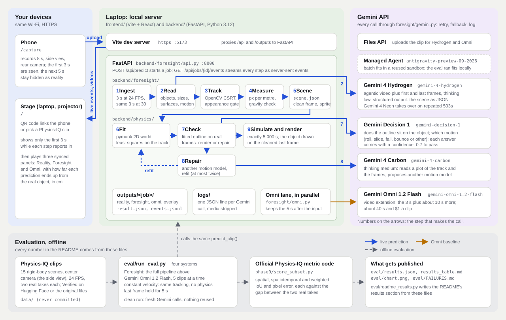
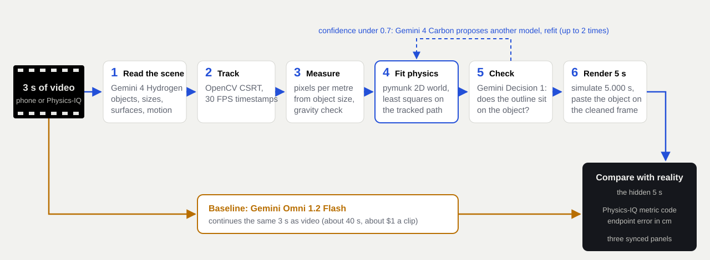

# Architecture

Foresight has three parts: the **backend** (`backend/foresight/`), which turns a 3 second clip into a scene a
physics engine can run; the **physics module** (`backend/physics/`), which fits and runs that scene for 5 seconds
and checks itself with Gemini; and the **stage** (`frontend/`), which records on a phone and shows the result next
to reality and next to Gemini Omni. The interfaces between them are in [../CONTRACT.md](../CONTRACT.md).

The same pipeline as a flow:

## From a clip to a scene (`backend/foresight/`)

1. **Ingest** (`api.py`, `video.py`): a phone upload (webm, mp4 or mov) becomes a constant-frame-rate 3 s
   conditioning clip at 24 FPS, the same 3 s at 30 FPS for fitting, and the hidden next 5 s. Physics-IQ clips
   come split already. The 24 FPS Physics-IQ files drop every fifth frame of the 30 FPS originals, so timing for
   the fit always comes from the 30 FPS clip.
2. **Read the scene** (`perceive.py`): Gemini 4 Hydrogen gets the clip with agentic video processing plus its
   first and last frames, at thinking level low, and returns a structured scene: each object as a circle or a box
   with its real size in cm and mass in grams, the surfaces it rolls on as line segments (hard or soft), and the
   kind of motion.
3. **Track** (`track.py`): OpenCV CSRT follows each moving object forward from the first frame and back from the
   last. CSRT rarely admits it has lost the object, so a frame only counts when the tracked patch still looks
   like the object. `clean_track` then keeps only free motion: the stretch before a held object is released, and
   first or last points the smooth path misses by more than 0.2 object sizes (an object half inside its pipe).
4. **Measure** (`scale.py`): pixels per metre come from the object's size in pixels and its real size. For falls,
   a parabola fitted to the track gives a second estimate from gravity.
5. **Assemble** (`scene.py`): the last frame with the object removed (filled from the first frame when the
   object was elsewhere, inpainted otherwise), a sprite of the object, keyframes for checking, and
   `scene.json` (CONTRACT.md §1). Rolling objects at the same depth share one support line fitted through all
   their bottoms; an object rolling at another depth gets its own.

## Physics (`backend/physics/`)

A 2D pymunk world is built from `scene.json`: surfaces solid below their line, dynamic circles and boxes for
the objects, gravity fixed at 9.81 m/s². `layers.py` reads depth from where things touch the table: each moving
object rolls in the layer of its support line; a static object whose bottom sits on that line blocks it (and is a
body at rest if it is light enough to be knocked), one lower in the image is in front and hides it, one higher is
behind. Containers are open on top. Tables and floors are level in 3D, so gravity along their drawn slope is
cancelled; soft surfaces absorb landings; balls brake with a rolling resistance of 0.04 g. `scipy.optimize.least_squares` fits the start position, velocity and
the material parameters the track can support; the rest keep priors. Gemini Decision 1 looks at keyframes with
the fitted outline drawn on them and answers whether it sits on the object, and which motion it is (roll,
slide, fall, bounce or other), each with a confidence. Under 0.7, Gemini 4 Carbon (thinking level low) looks
at a plot of the track and the keyframes and proposes another motion model and starting guesses; the fit runs
again, at most twice and within 90 s for the whole loop. The world then runs for exactly 5.000 s and is rendered
onto the cleaned frame, each object hidden behind what stands in front of it. If a simulated object moves faster
than its start speed plus free fall allows, the run falls back to constant velocity and reports why.

## The baselines (`backend/foresight/omni.py`, `genie.py`)

Gemini Omni 1.2 Flash gets the same 3 s and is asked to continue the scene (video extension). It returns the
input plus a continuation; the 5 s right after the input are kept. Genie 4 gets the last frame and a scene
prompt in a live session and streams video; the first 5 s are kept (padded with the last frame, and reported, if
the stream ends early).

## Serving (`backend/foresight/api.py`)

FastAPI. `POST /api/predict` starts a job and returns at once; `GET /api/jobs/{id}/events` streams every stage as
server-sent events (perception, tracking, scale, fit, Decision 1 confidences, repairs, fallback, render, Omni,
Genie), replaying past events to late listeners. The Omni and Genie lanes run in parallel. Every Gemini call goes through
`foresight/gemini.py`: retry with backoff on 503, a switch from Hydrogen to Neon if 503s continue, a hard stop on
429 (the project's spend cap), and a JSON line per call in `logs/` with the media stripped.

## The stage (`frontend/`)

Vite, React and Tailwind. The laptop shows a QR code; the phone records 8 s with the rear camera and uploads it;
the laptop shows only the first 3 s while the steps fill in, then plays Reality, Foresight, Omni and Genie 4 in
sync with the endpoint error under each.
